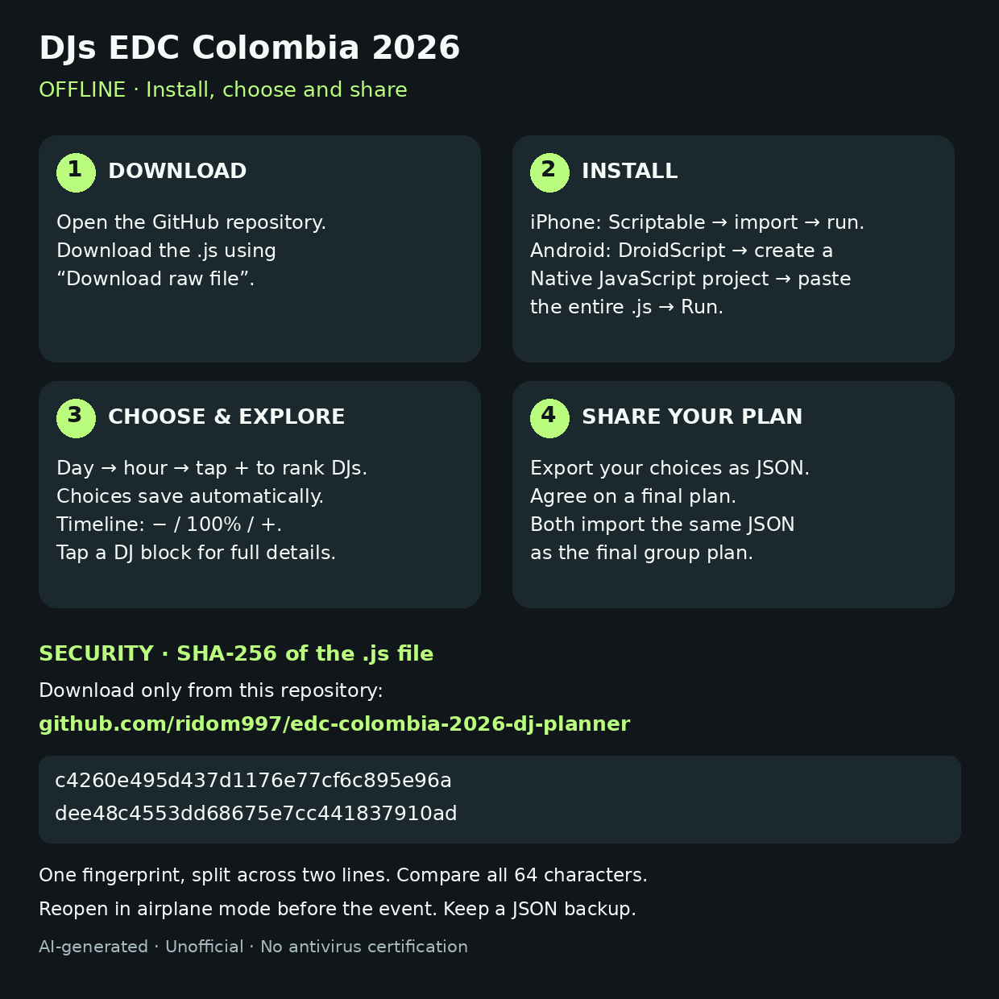
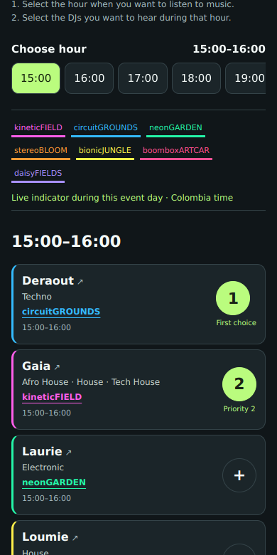
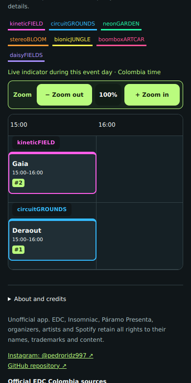
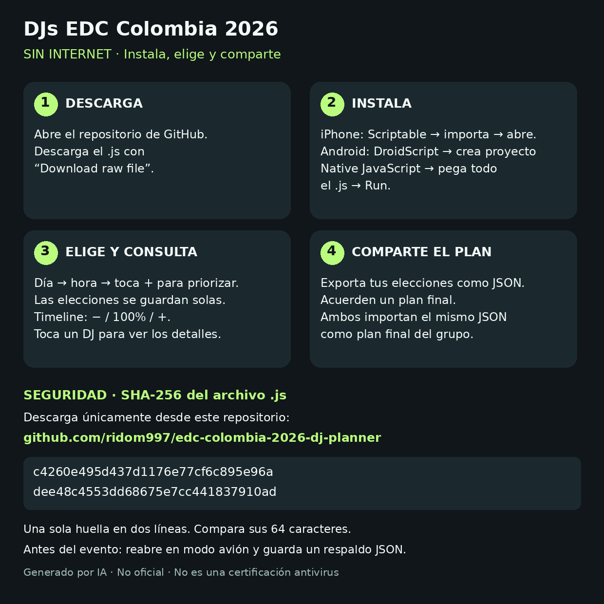
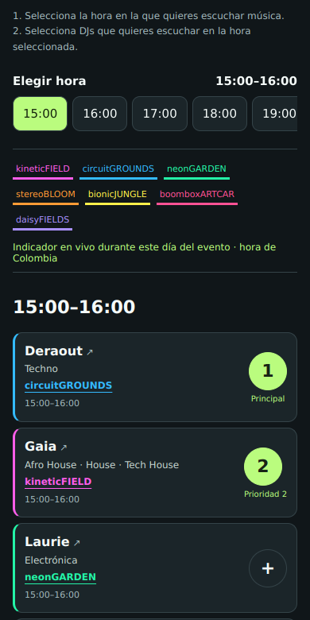
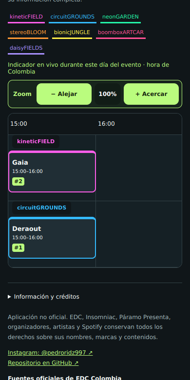
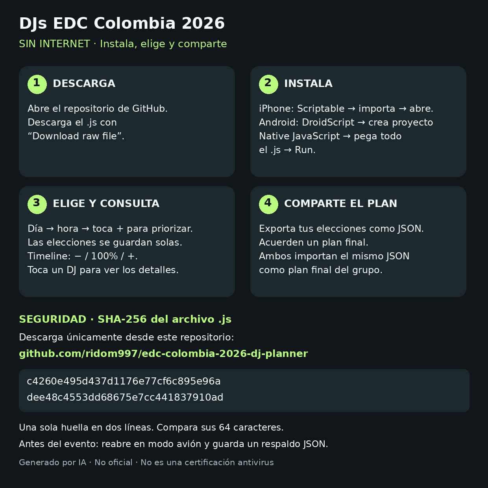

# Visual tutorial / Tutorial gráfico

**English first, Spanish below.** Installation panels are schematic instructions, not screenshots of Scriptable or DroidScript. Usage panels contain actual planner UI captured in Chromium with simulated native APIs, not physical-phone captures. Host menu labels may vary.

Download / Descarga: **https://github.com/ridom997/edc-colombia-2026-dj-planner**

## English — installation

Official downloads: [Scriptable](https://apps.apple.com/app/scriptable/id1405459188) · [DroidScript](https://play.google.com/store/apps/details?id=com.smartphoneremote.androidscriptfree).

Download [the complete JS](../DJs_EDC_Colombia_2026.js) using GitHub's **Download raw file** control. It contains both device adapters. Do not save the GitHub page itself. DroidScript requires a **Native JavaScript** project; a loose file is not an automatically installed app. If sharing to Scriptable is unavailable, create a script and paste the whole file.

## English — use and share

1. Open schedule and select the day.
2. Choose my DJs → hour buttons → tap + in order. Tap a number to remove it. Timeline − / + allows 50–160% zoom without reducing text size.
3. Continuing sets are already selected. Use Skip this hour / Resume without changing earlier hours; new priorities start at 1.
4. View set times → My set times → List or Timeline. Empty days show an explanation.
5. Return to the main menu. Export my choices and send the JSON manually.
6. Agree the group plan; one person adjusts their choices and exports the agreed JSON. Both import that same file as their final plan. Importing does not overwrite personal choices.
7. Choices save automatically. Reopen in airplane mode to check persistence before the event.

**If something goes wrong:** check that the entire JS was copied and that Android uses a Native JavaScript project. An empty personal/final view can simply mean no DJs were selected/imported for that day. A save error means you should retry before closing. An unavailable integrity check is not a virus verdict: the host may be unable to read its own script. Consult [the README](../README.md) and [security review](../SECURITY.md).

## Español — instalación

Las láminas de instalación son diagramas, no capturas de Scriptable ni DroidScript. Las de uso muestran la interfaz real de la app ejecutada en Chromium con APIs simuladas, no en un teléfono físico. Los nombres de menús del anfitrión pueden variar.

Descargas oficiales: [Scriptable](https://apps.apple.com/co/app/scriptable/id1405459188) · [DroidScript](https://play.google.com/store/apps/details?id=com.smartphoneremote.androidscriptfree).

Descarga [el JS completo](../DJs_EDC_Colombia_2026.js) con **Download raw file** en GitHub. Incluye la adaptación para ambos dispositivos. No guardes la página de GitHub como JS. DroidScript requiere un proyecto **Native JavaScript**: un archivo suelto no se instala automáticamente. Si no puedes compartir con Scriptable, crea un script y pega todo el archivo.

## Español — uso y compartir

1. Abre horarios y elige el día.
2. Elegir mis DJs → botones de hora → toca + en orden. Toca el número para quitarlo. El zoom − / + del timeline permite 50–160% sin reducir las letras.
3. Los sets que continúan ya están elegidos. Usa Quitar esta hora / Retomar sin cambiar horas anteriores; las nuevas prioridades empiezan en 1.
4. Visualizar set times → Mis set times → Lista o Timeline. Si el día está vacío, verás un aviso.
5. Vuelve al menú principal, exporta tus elecciones y envía el JSON manualmente.
6. Acuerden el plan grupal; una persona ajusta sus elecciones y exporta el JSON acordado. Ambos importan ese mismo archivo como plan final. No se sobrescriben las elecciones personales.
7. Las elecciones se guardan automáticamente. Reabre en modo avión antes del evento para comprobarlo.

**Si algo falla:** comprueba que copiaste todo el JS y que Android usa un proyecto Native JavaScript. Una vista personal/final vacía puede indicar que todavía no elegiste/importaste DJs para ese día. Si falla el guardado, reintenta antes de cerrar. Que la huella no se pueda comprobar no indica un virus: puede que el anfitrión no permita leer el propio script. Consulta el [README](../README.md) y la [revisión de seguridad](../SECURITY.md).

## Share with friends / Compartir con amigos

AI-generated promotional illustration, not a screenshot. / Ilustración promocional generada con IA, no una captura.
